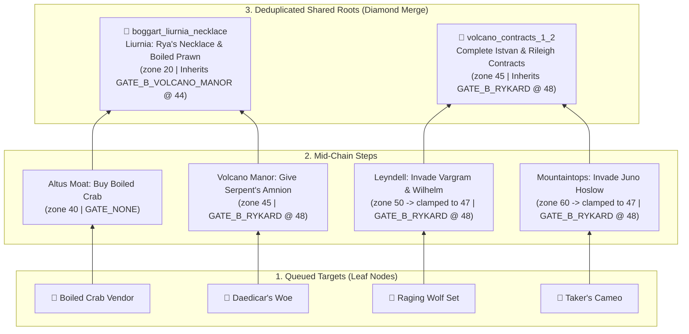

<div align="center">
  
  <h1>Elden Ring Current Run Roadmap (<code>er-ngplus-compiler</code>)</h1>
  <p><strong>Demand-driven geographical route &amp; Point-of-No-Return (PONR) compiler for Elden Ring &amp; Shadow of the Erdtree</strong></p>
  <p>
    <a href="https://er-ngplus-compiler.fastapicloud.dev"><strong>🌐 Live App (FastAPI Cloud)</strong></a>
    &nbsp;•&nbsp;
    
    
    
  </p>
</div>

---

## Overview

Most Elden Ring checklists force you to read through hundreds of chronological steps you don't care about—or worse, let you accidentally cross a **Point of No Return (PONR)** (like resting in Altus Plateau, joining Volcano Manor before Rya's Liurnia errand, looting the Castle Sol medallion before recruiting Latenna, killing Maliketh, or approaching Shadow Keep) that permanently locks out an item you wanted for your build.

**Elden Ring Current Run Roadmap** works like an optimizing compiler for your playthrough:
1. **Queue only the items you want** for your current NG / NG+ cycle (weapons, talismans, spells, spirit ashes, armor sets, cookbooks, or finite Ancient Dragon Smithing Stones).
2. **Unroll & Deduplicate Prerequisites:** The compiler expands multi-step NPC quests, merges shared prerequisites across multiple targets into single checkpoints, and automatically injects the **Realm of Shadow Access Spine** (`Radahn + Mohg`) whenever a DLC target is queued.
3. **Backward PONR Ceiling Propagation:** Every prerequisite step is mathematically clamped *before* the earliest downstream PONR gate that could lock it out.
4. **Same-Run Mutual Exclusivity Detection:** Queuing two items that cannot be obtained in the same cycle (e.g., *Millicent's Prosthesis* vs. *Rotten Winged Sword Insignia*, *Nepheli's 2× Ancient Stones* vs. *Nepheli Puppet*, *Glintstone Kris* vs. *Jerren's Ancient Stone*, *Retaliatory Crossed-Tree* vs. *Obsidian Lamina*) triggers an immediate collision banner with one-click resolution.
5. **Laconic, Fextralife-Verified Checkpoints:** Every step is cross-referenced against Fextralife and written in a crisp, zero-handholding format (`[Region / Grace]: [Action & Target] [PONR Constraint]`).

---

## Untangling "Miyazaki's Quest Knot": The Dependency-Inverted DAG

Traditional Elden Ring walkthroughs suffer from **forward state-machine explosion**: they walk forward from Limgrave to Enir-Ilim trying to track *every* NPC simultaneously. Because crossing a single invisible boundary (resting in Altus, entering Volcano Manor, looting the Castle Sol medallion, killing Maliketh, or approaching Shadow Keep) mutates global world state, a player who only wants 6 specific items has to mentally simulate 40+ interleaved questlines—or discover 30 hours later that a late-game item was silently locked out back in Liurnia.

**`er-ngplus-compiler` inverts the problem.** Instead of pushing you forward through every quest in the game, it treats your **queued desirable items as leaf nodes** in a **Directed Acyclic Graph (DAG)** and resolves only what you need, walking **backward from the loot to its earliest prerequisites**:



### How the 4-Pass Solver Works ([`compiler.py`](compiler.py))

#### Pass 1 — Demand-Driven Tree Shaking & Diamond Deduplication (`step_key`)
Only prerequisite chains reachable from your queued targets are pulled from [`ngplus.db`](ngplus.db). When multiple targets depend on the same ancestor step (a "diamond dependency" like `boggart_liurnia_necklace`, `volcano_contracts_1_2`, `moore_thiollier_concoction`, or `ansbach_freyja_scroll`), the DAG merges them into a **single checkpoint** with combined target badges, inheriting the **strictest (minimum)** geographical position and PONR ceiling of all dependents.

#### Pass 2 — Backward PONR Ceiling Propagation
A quest step might take place in a late-game region (e.g., invading Juno Hoslow in Mountaintops at `zone 60` or Vargram in Leyndell at `zone 50`), while its lockout boss sits in an earlier zone (`GATE_B_RYKARD` at `pos 48`). For every chain $S = (s_1, s_2, \dots, s_k)$, `compile_run_plan()` walks **backward** ($i = k \dots 1$):
- It propagates the earliest downstream lockout ceiling upward:
  $$C_i = \min\big(C_{i+1},\; \text{pos}(\text{gate}(s_i))\big)$$
- It clamps each step's scheduled position strictly before that ceiling:
  $$\text{scheduled\_pos}(s_i) = \min\big(Z(s_i),\; C_i - 1\big)$$
- This guarantees that every prerequisite is scheduled in the route leg **before** the PONR stop banner that would break the chain.

#### Pass 3 — Geographical Progression Weighting (`zone_order`)
To sort all surviving checkpoints along **natural game flow**, every region and landmark is assigned a canonical **geographical progression weight (`zone_order`)**:
- **Base Game (`10`–`80`):**
  - `10` Limgrave & Stormveil → `15` Weeping Peninsula → `20` Liurnia of the Lakes & Three Sisters → `25` Caelid & Dragonbarrow → `30` Nokron, Siofra & Underground → `40` Altus Plateau & Capital Outskirts → `45` Mt. Gelmir & Volcano Manor → `50` Leyndell & Subterranean Shunning-Grounds → `60` Mountaintops of the Giants → `70` Consecrated Snowfield & Mohgwyn Palace → `75` Elphael & Haligtree → `80` Crumbling Farum Azula & Ashen Capital.
- **Shadow of the Erdtree (`100`–`160`):**
  - `100` Gravesite Plain → `105` Cerulean Coast & Charo's Hidden Grave → `108` Belurat, Tower Settlement → `112` Castle Ensis → `114` Stone Coffin Fissure → `120` Scadu Altus → `125` Cathedral of Manus Metyr → `130` Shadow Keep & Hinterland → `140` Jagged Peak → `150` Ancient Ruins of Rauh → `152` Abyssal Woods → `160` Enir-Ilim.

Static regional pickups and multi-step quest prerequisites are interleaved by `(zone_order, seq)`, so you sweep each region once in natural progression order without needless backtracking.

#### Pass 4 — Same-Run Mutual Exclusivity Collision Detection (`exclusive_group`)
Certain rewards are strictly mutually exclusive in a single playthrough (consuming a single *Seluvis's Potion*, *Heart of Bayle*, or *Iris of Grace/Occultation*, or choosing between Red and Gold summon signs). Whenever 2+ items from the same `exclusive_group` are queued, the solver flags the collision at the top of the workspace with one-click buttons to drop either branch.

---

## Point-of-No-Return (PONR) Gates

| Gate ID | Timeline Pos | Campaign | Lockout Trigger | Notable Missables Protected |
| :--- | :---: | :--- | :--- | :--- |
| `GATE_B_ALTUS` | `38` | Base Game | Resting at any Altus Plateau Grace / triggering Radahn Festival | *Ash of War: Raptor of the Mists* (Yura bridge invasion), *Rogier's Rapier +8*, Corhyn / Alexander early placements |
| `GATE_B_FINGERSLAYER` | `42` | Base Game | Giving the Fingerslayer Blade to Ranni at Ranni's Rise | *Magic Scorpion Charm*, *Dung Eater Puppet*, *Nepheli Loux Puppet*, *Spellblade Set* |
| `GATE_B_VOLCANO_MANOR` | `44` | Base Game | Resting inside Volcano Manor / pledging service to Tanith | Blackguard Boggart's *Boiled Prawn & Boiled Crab* vendor unlock, *Daedicar's Woe* setup, *Hammer Talisman* (Recusant Henricus) |
| `GATE_B_RYKARD` | `48` | Base Game | Defeating Rykard, Lord of Blasphemy | *Raging Wolf Set*, *Bull-Goat Set*, *Magma Whip Candlestick*, *Taker's Cameo*, *Hoslow's Set*, *Serpentbone Blade*, *Scaled Set*, *Crepus's Vial*, *Gelmir's Fury*, *Daedicar's Woe* |
| `GATE_B_CASTLE_SOL` | `62` | Base Game | Looting Haligtree Secret Medallion (Left) at Castle Sol | Latenna's *Somber Ancient Dragon Smithing Stone* (if Latenna wasn't recruited in Liurnia first) |
| `GATE_B_MALIKETH` | `85` | Base Game | Defeating Maliketh, the Black Blade (Leyndell → Ashen Capital) | *Bolt of Gransax*, *Gravel Stone Seal*, *Sanctified Whetblade*, *Coded Sword*, *Barrier of Gold*, *Black Bow*, *Lionel's Set*, *Deathbed Dress*, *Alberich's Set*, *Two Fingers' Prayerbook*, *Gargoyle's Halberd*, *Battle Hammer & Duelist Set*, *Hammer*, *Omensmirk Mask*, *Guardian Garb (Full Bloom)*, *Fire's Deadly Sin*, *By My Sword*, Goldmask & Nepheli/Gostoc setups |
| `GATE_S_RUNEBREAK` | `115` | Shadow of the Erdtree | Approaching Shadow Keep / crossing north of Bonny Village | Moore's *Black Syrup* → *Thiollier's Concoction*, *Dragonbolt of Florissax*, *Florissax Spirit Ash*, *Deadly Poison Perfume Bottle* |
| `GATE_S_MESSMER` | `135` | Shadow of the Erdtree | Opening Messmer's Dark Chamber / defeating Messmer | *Watchful Spirit* (Hornsent Grandam), *Lacerating Crossed-Tree*, *Ash of War: Swift Slash*, *Retaliatory Crossed-Tree*, *Ansbach's Longbow*, *Golden Lion Shield*, *Obsidian Lamina* & *Freyja's Greatsword* setups |
| `GATE_S_ROMINA` | `155` | Shadow of the Erdtree | Burning the Sealing Tree after Romina, Saint of the Bud | *Falx* (Hornsent Rauh stairs invasion), *St. Trina's Smile*, *Thiollier's Hidden Needle*, *St. Trina's Blossom*, *Dryleaf Arts & Dane's Hat*, *Verdigris Greatshield & Set*, *Forager Brood Cookbook [7]* |
| `GATE_NONE` | `200` | Post-Gate / Open Sweep | Open regional sweep (no further world-state lockouts) | All remaining static pickups, boss drops, and finite Ancient / Somber Ancient Dragon Smithing Stones |

---

## Same-Run Mutual Exclusivity Groups (`exclusive_group`)

| Exclusive Group | Mutually Exclusive Choices (Single NG Cycle) |
| :--- | :--- |
| `EX_SELUVIS_POTION` | **Dung Eater Puppet** vs. **Nepheli Loux Puppet** vs. **Nepheli & Gostoc's 2× Ancient Dragon Smithing Stones** / **Mending Rune of the Fell Curse** |
| `EX_SELLEN_JERREN` | **Glintstone Kris, Shard Spiral & Witch's Crown** (Side with Sellen) vs. **Ancient Dragon Smithing Stone** (Side with Jerren) |
| `EX_MILLICENT_FINALE` | **Millicent's Prosthesis** (Kill/Betray Millicent) vs. **Rotten Winged Sword Insignia, Miquella's Needle & Somber Ancient Stone** (Assist Millicent) |
| `EX_ALEXANDER_JAR` | **Warrior Jar Shard (10%)** (Kill Alexander early) vs. **Shard of Alexander (15%)** & **Companion Jar** (Complete Farum Azula duel) |
| `EX_PATCHES_SURVIVAL` | **Bull-Goat Set & Magma Whip Candlestick** (Spare Patches) vs. Killing Patches early in Murkwater Cave |
| `EX_FLORISSAX_CHOICE` | **Dragonbolt of Florissax & Florissax Spirit Ash** (Give Concoction) vs. **Flowerstone Gavel & Priestess Heart** (No Concoction) |
| `EX_LEDA_HORNSENT` | **Lacerating Crossed-Tree** (Invade Hornsent with Leda) vs. **Ash of War: Swift Slash** (Defend Hornsent against Leda) |
| `EX_LEDA_ANSBACH` | **Retaliatory Crossed-Tree** (Invade Ansbach with Leda) vs. **Obsidian Lamina & Furious Blade of Ansbach** (Keep Ansbach alive) |
| `EX_JOLAN_IRIS` | **Sword of Night** (*Iris of Occultation*) vs. **Swordhand of Night Jolán / Jolán and Anna Spirit Ash** (*Iris of Grace*) |
| `EX_QUEELIGN_IRIS` | **Queelign's Greatsword** (*Iris of Occultation*) vs. **Fire Knight Queelign Spirit Ash** (*Iris of Grace*) |
| `EX_BAYLE_HEART` | **Bayle's Tyranny** vs. **Bayle's Flame Lightning** (1× *Heart of Bayle* per cycle) |

---

## Tech Stack & Architecture

- **Backend:** [FastAPI](https://fastapi.tiangolo.com/) ([`main.py`](main.py)) + Jinja2 server-rendered templates ([`templates/`](templates/)).
- **Frontend:** [HTMX `1.9.12`](https://htmx.org/) + Tailwind CSS. Zero client-side JS framework; mobile-first PWA with custom Great Rune vector icons ([`static/`](static/)).
- **Database (`ngplus.db`):** Read-only SQLite 3 catalog with **FTS5** prefix typeahead search (`porter unicode61` tokenizer), prioritizing `[MISSABLE]` and curated multi-step chains.
- **Stateless Multi-User Persistence:** User state (`er_order` and `er_steps`) is stored in signed HTTP-only cookies (30-day TTL) with one-click portable **💾 Export JSON** (`GET /export`) and **📂 Import JSON** (`POST /import`). SQLite is strictly read-only at runtime so concurrent cloud users never collide.

---

## Local Development

Requires Python 3.11+ and [`uv`](https://docs.astral.sh/uv/).

```bash
# 1. Install dependencies
uv sync

# 2. Run the development server (http://127.0.0.1:8000)
uv run fastapi dev main.py

# 3. Rebuild ngplus.db offline from curated rules + SOTE catalog
uv run python -c "import populate_full_db; populate_full_db.populate_all(fetch_online=False)"

# 4. (Optional) Full online rebuild including eldenring.fanapis.com fetch
uv run python populate_full_db.py
```

---

## Repository Structure

```text
├── main.py                      # FastAPI app, FTS5 /search, HTMX state endpoints, JSON export/import
├── compiler.py                  # Route & PONR solver (backward ceiling propagation, zone spine, deduplication)
├── populate_full_db.py          # Curated quest/PONR ruleset generator, SOTE catalog & FanAPI seeder
├── seed_db.py                   # SQLite schema & FTS5 initializer
├── quest_rules.json             # Canonical JSON ruleset (10 PONR gates, 82 curated item chains)
├── ngplus.db                    # Pre-seeded SQLite 3 + FTS5 catalog (1,241 items)
├── static/                      # Custom PWA icons, SVG favicon & webmanifest
└── templates/
    ├── index.html               # App shell, Export/Import/Reset bar & floating FTS5 search overlay
    └── partials/workspace.html  # HTMX partial: progress bar, conflict alerts, targets & collapsible route legs
```
