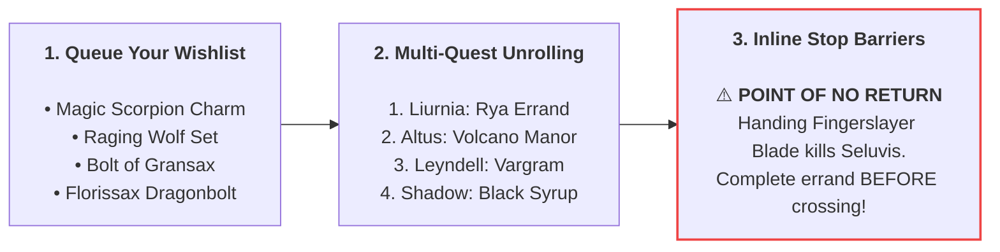

<div align="center">
  
  <h1>Elden Ring Current Run Roadmap</h1>
  <p><strong>The smart, missable-proof route planner for Elden Ring &amp; Shadow of the Erdtree</strong></p>
  <p>
    <a href="https://er-ngplus-compiler.fastapicloud.dev"><strong>🌐 Launch Web App</strong></a>
    &nbsp;•&nbsp;
    <a href="https://github.com/mortalezz/er-roadmap/releases/latest"><strong>🍎 Download macOS Companion (1.5 MB, Offline)</strong></a>
    <br/>
    
    
    
    
  </p>
</div>

---

## What is Elden Ring Roadmap?

If you're starting a new game, an NG+ run, or prepping a new build for PvP/co-op, you probably have a mental wishlist:
* *"I want the Magic Scorpion Charm, the Raging Wolf armor set, the Bolt of Gransax, and Dragonbolt of Florissax."*

The problem? **Elden Ring's quests are full of invisible tripwires.** 
* Rest at an Altus Plateau site of grace too early? *Alexander, Corhyn, and Yura's quests jump forward.*
* Join Volcano Manor before doing Rya's errand in Liurnia? *Blackguard Boggart is locked out forever (no Boiled Crab for your run).*
* Loot the Secret Medallion at Castle Sol before recruiting Latenna? *She dies where she sits.*
* Defeat Rykard? *Every Volcano Manor assassination contract vanishes.*
* Cross north of Bonny Village in the DLC? *Miquella's Great Rune breaks, locking out Moore's and Thiollier's concoctions.*
* Defeat Maliketh? *Leyndell turns to ash, burying the Bolt of Gransax and Sanctified Whetblade.*

Knowing the major bosses isn't enough—most items lock out because of an **obscure prerequisite 3 regions earlier** that you didn't know was connected. Traditional 100-page walkthroughs force you to read through hundreds of chronological steps for items you don't even want.

**Elden Ring Roadmap inverts the entire process:**
You select **only the items you want for your build**, and the compiler cross-references **82 curated quest rules (covering all 68 permanently missable items)** against **10 hard Point-of-No-Return (PONR) gates** to deliver two ironclad guarantees:

> 1. **You Won't Lose Anything:** Prerequisite steps are mathematically clamped *before* the downstream gates that would lock them out, placing bold red stop barriers on your checklist until it's safe to proceed.
> 2. **Zero Needless Backtracking:** Multi-step NPC quests and static pickups are merged and interleaved into a single, natural geographical progression path. You sweep each region once.

---

## How It Works



### 1. Queue Only What You Care About
Search from **1,241 weapons, talismans, spells, armor sets, spirit ashes, cookbooks, and upgrade materials** across both the Base Game and *Shadow of the Erdtree*. Add only the loot you want for this run.

### 2. 68 Curated Missables Unrolled Step-by-Step
Every missable item in the game has its full prerequisite chain mapped out. 
* Want the **Raging Wolf Set**? The compiler knows you must talk to Bernahl, do Rya's Liurnia errand, join Volcano Manor, finish Contracts 1 & 2, and invade Vargram in Leyndell *before* Rykard or Maliketh dies.
* Want **Dragonbolt of Florissax**? The compiler knows you must talk to Thiollier and Moore *before* Miquella's Great Rune breaks, then administer the draught at Jagged Peak *before* fighting Bayle.

### 3. Backward Gate Clamping & Stop Barriers
If Step 4 of a quest is locked out by a late-game boss, the compiler **propagates that ceiling backward**, scheduling Steps 1, 2, and 3 into the route *before* the point of no return:
* **🔴 Red Barrier:** *"DO NOT TRIGGER YET — Handing the Fingerslayer Blade to Ranni will lock out Seluvis and the Magic Scorpion Charm."*
* **🟢 Green Clear:** Once all prerequisites are checked off, the barrier turns green: *"SAFE TO CROSS POINT OF NO RETURN."*

### 4. Zero Backtracking (Geographical Region Spine)
Static pickups, bosses, and quest errands in the same area are grouped together along natural game flow:
> **Limgrave → Weeping Peninsula → Liurnia → Caelid → Underground (Siofra/Nokron) → Altus Plateau → Mt. Gelmir → Leyndell → Mountaintops → Snowfield / Mohgwyn → Farum Azula → Realm of Shadow**

When multiple queued items share a prerequisite (like Volcano Manor invitations or Moore's syrup), the compiler merges them into a **single checkpoint** with combined target badges so you never repeat work.

### 5. Build Conflict Detection
Certain rewards are strictly mutually exclusive in a single playthrough (e.g. *Millicent's Prosthesis* vs. *Rotten Winged Sword Insignia*, or *Nepheli Puppet* vs. *Dung Eater Puppet*). The planner immediately highlights collisions with a one-click button to resolve your choice.

---

## Play Your Way: Web, Mobile, or Companion App

Whether you play next to a dual monitor, keep a laptop on your gaming desk, or prop your phone against your TV, the roadmap fits your battlestation setup:

### 🌐 Live Web App (Fast & Mobile-Friendly)
Open [**er-ngplus-compiler.fastapicloud.dev**](https://er-ngplus-compiler.fastapicloud.dev) in any browser.
* **Instant Load:** Static shell cached at Cloudflare's Edge CDN worldwide for sub-20ms first paint.
* **Installable PWA:** Open in Safari on iOS or Chrome on Android and tap **"Add to Home Screen"** for a full-screen, standalone app experience with no browser address bar.
* **No Accounts / No Passwords:** Your checklist is saved automatically in your browser.

### 🍎 Native macOS Companion App (`1.5 MB`, 100% Offline)
Keep a MacBook or Mac mini open next to your gaming PC or console? Grab the native companion app:
* **Download:** Grab [`ER-Roadmap-macOS-arm64.zip`](https://github.com/mortalezz/er-roadmap/releases/latest) from Releases, unzip, and launch **`ER Roadmap.app`**.
* **Zero Internet Required:** Completely self-contained single binary with embedded styling and catalog. Runs smoothly even on airplane mode or spotty Wi-Fi.
* **Microsecond Speed:** Powered by a native Rust route solver and Cocoa WebKit runtime (~0.02 ms response time).

### 💾 Seamless Multi-Device Sync (Tiny 1 KB File)
Switching between your companion desk app and your phone mid-playthrough?
1. Click **💾 Export JSON** on your Mac/PC (downloads a tiny `~1 KB` file).
2. AirDrop, text, or email the file to your phone.
3. Open the Web App on your phone, click **📂 Import JSON**, and select the file.
4. Your entire wishlist, checked steps, and progress are instantly restored.

---

## The 10 Major Lockout Gates Protected

Every quest step in our 82 rulesets is tied to one of these 10 hard world boundaries:

| Gate ID | Lockout Trigger | Key Missables Protected |
| :--- | :--- | :--- |
| **`GATE_B_ALTUS`** | Resting at Altus Plateau / triggering Radahn Festival | *Raptor of the Mists* ash of war, *Rogier's Rapier +8*, early Corhyn/Alexander dialogue |
| **`GATE_B_FINGERSLAYER`** | Handing Fingerslayer Blade to Ranni | *Magic Scorpion Charm*, *Dung Eater Puppet*, *Nepheli Loux Puppet*, *Spellblade Set* |
| **`GATE_B_VOLCANO_MANOR`** | Joining Volcano Manor before Liurnia errand | Blackguard Boggart vendor (*Boiled Prawn / Boiled Crab*), *Hammer Talisman* |
| **`GATE_B_RYKARD`** | Defeating Rykard, Lord of Blasphemy | *Raging Wolf Set*, *Bull-Goat Set*, *Magma Whip Candlestick*, *Taker's Cameo*, *Hoslow's Set*, *Crepus's Vial*, *Gelmir's Fury* |
| **`GATE_B_CASTLE_SOL`** | Looting Haligtree Secret Medallion (Left) | Latenna's *Somber Ancient Dragon Smithing Stone* (kills Latenna if not recruited in Liurnia) |
| **`GATE_B_MALIKETH`** | Defeating Maliketh (Leyndell → Ashen Capital) | *Bolt of Gransax*, *Sanctified Whetblade*, *Gravel Stone Seal*, *Coded Sword*, *Lionel's Set*, *Barrier of Gold*, *Black Bow* |
| **`GATE_S_RUNEBREAK`** | Approaching Shadow Keep / crossing Bonny Village (DLC) | Moore's *Black Syrup*, *Thiollier's Concoction*, *Dragonbolt of Florissax*, *Florissax Spirit Ash* |
| **`GATE_S_MESSMER`** | Opening Messmer's Dark Chamber (DLC) | *Lacerating Crossed-Tree*, *Ash of War: Swift Slash*, *Retaliatory Crossed-Tree*, *Hornsent Grandam* dialogue |
| **`GATE_S_ROMINA`** | Burning the Sealing Tree after Romina (DLC) | *Falx* invasion, *St. Trina's Smile*, *Thiollier's Needle*, *Dryleaf Arts & Dane's Hat*, *Verdigris Greatshield* |
| **`GATE_NONE`** | Open Regional Sweep | Boss drops, finite Ancient / Somber Ancient Dragon Smithing Stones (safe at any time) |

---

## Mutual Exclusivity Quick Reference

These items cannot be obtained in the same NG cycle; queuing both will alert you immediately:

* **Millicent's Quest:** *Millicent's Prosthesis* (betray) **vs.** *Rotten Winged Sword Insignia & Miquella's Needle* (assist).
* **Seluvis's Potion:** *Dung Eater Puppet* **vs.** *Nepheli Loux Puppet* **vs.** *2× Ancient Dragon Smithing Stones* (Nepheli/Gostoc).
* **Sorceress Sellen:** *Glintstone Kris & Witch's Crown* (side with Sellen) **vs.** *Ancient Dragon Smithing Stone* (side with Jerren).
* **Dragon Communion Priestess:** *Dragonbolt of Florissax & Spirit Ash* (administer sleep draught) **vs.** *Flowerstone Gavel & Priestess Heart* (no draught).
* **Leda's Invasions:** *Lacerating Crossed-Tree* (side with Leda) **vs.** *Ash of War: Swift Slash* (side with Hornsent).
* **Hornsent / Ansbach:** *Retaliatory Crossed-Tree* (side with Leda) **vs.** *Obsidian Lamina & Furious Blade* (keep Ansbach alive).
* **Iris of Grace vs. Occultation:** *Sword of Night* **vs.** *Jolán Spirit Ash* (Jolán), and *Queelign's Greatsword* **vs.** *Queelign Spirit Ash*.
* **Heart of Bayle:** *Bayle's Tyranny* **vs.** *Bayle's Flame Lightning* (1× Heart per cycle).

---

<details>
<summary><strong>🛠️ Under the Hood: Architecture & Developer Notes</strong></summary>

### The Dependency-Inverted DAG Solver
Traditional walkthroughs walk forward trying to track everything at once. `er-ngplus-compiler` treats your queued items as leaf nodes in a **Directed Acyclic Graph (DAG)** and solves **backward from the loot to its earliest prerequisites**:
1. **Tree Shaking & Diamond Deduplication:** Pulls only prerequisites needed for your targets and merges shared ancestor steps (like `volcano_contracts_1_2` or `moore_thiollier_concoction`) into single checkpoints with combined target badges.
2. **Backward PONR Ceiling Propagation:** Iterates backward through multi-step chains to clamp every prerequisite *before* the earliest downstream lockout gate ($pos(s_i) = \min(Z(s_i), C_i - 1)$).
3. **Geographical Ordinal Weighting:** Sorts all surviving checkpoints along canonical progression numbers (`zone_order` 10–160).
4. **Collision Detection:** Flags multiple items sharing an `exclusive_group`.

### Tech Stack
* **Cloud App:** FastAPI (`main.py`) + HTMX + Cloudflare Edge CDN caching via `app.frontend("/", directory="dist")`.
* **Database:** SQLite 3 catalog + FTS5 full-text search (`ngplus.db`, 1.1 MB, zero write locks, read-only mode).
* **Stateless Cookies:** `v2_` zlib level 9 + URL-safe Base64 codec compresses 68 simultaneous missables into ~1 KB, dodging the browser 4 KB limit. Single-tab mutations serialized via `hx-sync="this:queue"`.
* **Native Desktop Port (`rust-port/`):** Pure-Rust AOT `.tsx` compiler that compiles React-style templates into zero-allocation string writers, bundled with an embedded Cocoa `WKWebView` IPC bridge (`20.7 µs` solve time, `1.5 MB` binary).

### Local Development & Compiling

```bash
# Clone the repository
git clone https://github.com/mortalezz/er-roadmap.git
cd er-roadmap

# Install Python dependencies and run web app locally
uv sync
python build_dist.py
uv run fastapi dev main.py
```

#### Compiling the Rust Engine (`rust-port/`)
The Rust engine is built with zero third-party crate dependencies. The catalog and JSX templates are compiled ahead-of-time directly into `.rodata`.

* **macOS (Official & Tested):**
  Assembles the standalone native Cocoa + WKWebView `.app` bundle:
  ```bash
  ./rust-port/build_macos_app.sh
  open "rust-port/ER Roadmap.app"
  ```

* **Windows & Linux (Community / Experimental):**
  > [!NOTE]
  > **Disclaimer:** Compiling on Windows or Linux has **not been tested by the author**. The macOS companion app (Cocoa/WebKit) is the author's primary tested target. Contributions, testing feedback, and PRs for other platforms are very welcome!

  On non-macOS systems, the binary compiles without Objective-C and defaults to a zero-dependency local microsecond HTTP server:
  ```bash
  cd rust-port

  # Build release binary (requires Rust toolchain: cargo)
  cargo build --release

  # Run local microsecond server (starts on http://127.0.0.1:8080)
  cargo run --release

  # Or run engine micro-benchmarks
  cargo run --release -- --bench
  ```
  *(Tip for Windows GUI developers: You can pair this local binary with a native Microsoft Edge WebView2, Tauri, or Wry window for an offline Windows app.)*
</details>

---

## Acknowledgments & Community Credits

Special thanks to engineers from [r/FastAPI](https://www.reddit.com/r/FastAPI/) whose sharp architectural peer reviews directly elevated the production engineering of this project:

* [**u/pvnimaxin**](https://www.reddit.com/user/pvnimaxin/) — for calling out Python `SimpleCookie` octal escaping bloat (`\054`), guiding the `v2_` binary `zlib` + `base64url` compression design to compress 68 simultaneous missables well under the 4 KB browser limit, and advising on bounded decompression limits and `Cache-Control` / `Vary` cache-busting headers.
* [**u/DismalCockroach1928**](https://www.reddit.com/user/DismalCockroach1928/) — for analyzing concurrent in-flight mutation edge cases (Read-Modify-Write / Lost Update on stateless cookies) and recommending HTMX `hx-sync="this:queue"` to strictly serialize mutation controls.

---

## License

Released under the [MIT License](LICENSE). 
Elden Ring and Shadow of the Erdtree are trademarks of FromSoftware and Bandai Namco. This project is an independent fan-made tool.
